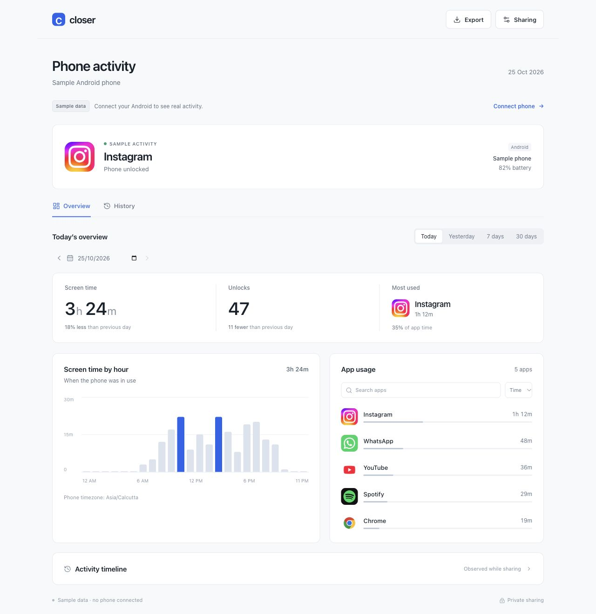

# Closer

[](https://github.com/HarshitKumar9030/closer/actions/workflows/ci.yml)

Privately share your Android phone activity with your partner. Native Android companion, minimal web dashboard, and MongoDB history. One Node service. No frontend framework.



## What it does

- Shares the current app, screen time, unlock count and battery, normally within 5–10 seconds.
- Displays actual installed app icons; uses [Lucide](https://lucide.dev/) for interface icons.
- Offers daily, 7-day and 30-day summaries, app search, sorting and per-app details.
- Keeps history until you delete it, with date filters, cursor pagination and CSV export.
- Shows an activity timeline observed while sharing; offline gaps are left empty.
- Gives you explicit pairing, a persistent notification, pause controls and revocable read-only links.

**Android 10+ only.** Your partner can use any modern browser. The sample dashboard is clearly labelled and never represents your actual phone usage.

## Quick start

Requires Node.js 24 LTS or newer, MongoDB 8, and Python 3 for Android builds.

```sh
git clone https://github.com/HarshitKumar9030/closer.git
cd closer
npm ci
npm run setup
```

Start MongoDB locally, then start Closer:

```sh
mkdir -p data/mongo
mongod --dbpath ./data/mongo --bind_ip 127.0.0.1 --port 27017
# In a second terminal:
npm run dev
```

Open **http://127.0.0.1:8787**. The generated `.env` contains your owner key. Enter it in **Sharing** to create a pairing code. For MongoDB Atlas or an existing database, set `MONGODB_URI` in `.env` instead.

## Connect your phone

Build the companion with an installed JDK and Android SDK API 36+:

```sh
npm run build:android
```

Install `android/build/closer-debug.apk`, enter your server's HTTPS URL and pairing code, enable Usage Access, grant notification permission and tap **Start sharing**. Create a viewing link and send it to your partner.

For USB development, forward port 8787 with `adb reverse tcp:8787 tcp:8787`, then use `http://127.0.0.1:8787` in the app. An emulator can use `http://10.0.2.2:8787`. Local development links do not work across networks.

## Self-host with HTTPS

Point a domain at your server and allow inbound ports 80 and 443. Set `CLOSER_DOMAIN` in `.env`, then run:

```sh
docker compose up -d --build
```

The stack contains the app, authenticated MongoDB on a private container network, and Caddy for automatic HTTPS. Data persists in the `mongo-data` volume. The app uses a database-specific account; root database credentials are not passed to it.

See [deployment, backups and upgrades](docs/DEPLOYMENT.md) before sharing live data. For the earlier SQLite build, use the [migration instructions](docs/DEPLOYMENT.md#migrate-from-sqlite).

## Privacy and limits

Only app names/icons, usage totals, unlocks and battery are shared. Closer does not read messages, screenshots, location or browsing content. Anyone with a viewing link can read the shared history until you revoke it. Pausing hides history and live activity on the server; deleting a phone removes its records.

There is **no automatic history expiry**. Retention is limited by your database capacity and backups. History starts when the phone first uploads; older days are not backfilled. Daily totals on resume include time while sharing was paused. The sampled activity timeline begins only while sharing is active.

Android battery restrictions, Doze and network loss can delay updates. A phone is marked offline after 30 seconds without a sync. Reopen Closer to resume after a restart or force-stop. Totals can differ from the manufacturer's Digital Wellbeing app, particularly with split-screen or delayed usage events.

## Development and releases

```sh
npm test                 # requires an isolated MongoDB test instance
npm run build:web
npm run build:android
```

[Development and test setup](docs/DEVELOPMENT.md) · [Android signing and release checks](docs/RELEASING.md) · [Security](SECURITY.md) · [Contributing](CONTRIBUTING.md)

CI tests MongoDB behavior, builds and smoke-tests the production container, validates the web bundle, runs the Java usage reducer tests, and builds a development APK. Physical-device battery behavior and Play Store approval still require device testing and the normal distribution review.

The optional private Sites preview is a visual demo. Its sign-in gate blocks background phone uploads; use your self-hosted server for live sharing. Preview project identity and credentials are excluded from this repository.

## License

Project code is [MIT licensed](LICENSE). Lucide, MongoDB and app-brand assets retain their own licenses and ownership; see [third-party notices](THIRD_PARTY_NOTICES.md).
